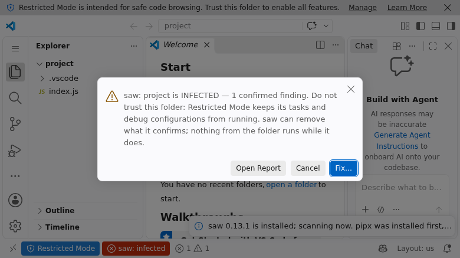
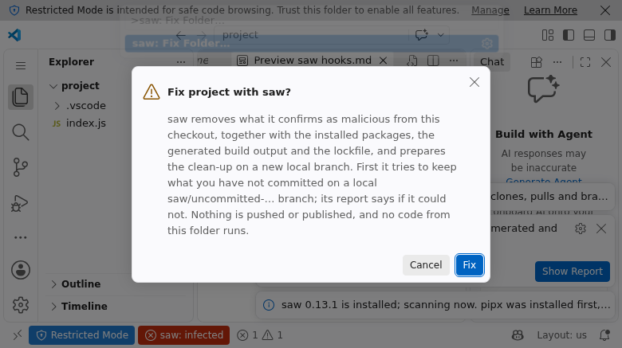
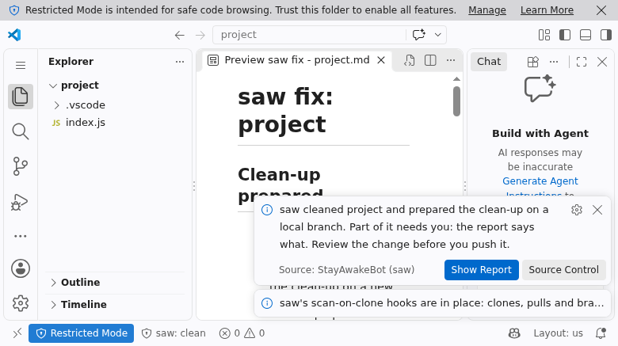

# StayAwakeBot (saw)

**Catch supply-chain worms before they run.** The [saw](https://saw-docs.ndevuspace.com/) scanner in
VS Code, Cursor, Antigravity, Devin Desktop and VSCodium: a verdict for every folder you open,
before you trust it.

Supply-chain worms hide where a developer never looks: an editor task that runs when a folder
opens, an obfuscated loader in an installed package, a poisoned lockfile, a git hook that runs on
checkout. **saw** hunts them, and this extension runs saw for you. It scans each folder, shows the
verdict where you work, and, when you ask, cleans the folder up.

## Features

### A verdict for every folder

Each workspace folder is scanned when the window opens, and again when something that can run code
changes: a saved file, a checkout or pull, or a change under `.vscode/`, `package.json`, a lockfile,
a workflow or a git hook. The verdict appears in the status bar and the **saw** view, and findings
appear in the **Problems** panel.

| Verdict | Meaning |
| --- | --- |
| **infected** | At least one confirmed finding: the content is malicious. Don't trust, install, build or run anything in the folder. |
| **suspicious** | Heuristic findings only: something doesn't look right, and a person should decide. Nothing was changed. |
| **traces left** | Traces an infection left behind (saw calls this *residue*). Nothing found runs, but it isn't what the project would carry. |
| **could not scan** | The folder couldn't be fully scanned: unknown, never clean. |
| **clean** | Nothing found, and the folder was fully scanned. |

Read [what each verdict means](https://saw-docs.ndevuspace.com/latest/explanation/verdicts/) in saw's
documentation.

### Safe before you trust a folder

Scanning only reads files, so it runs in **Restricted Mode**. When saw confirms malware in a folder
you have not trusted yet, the extension warns you before you trust it.

### Chat

The saw sidebar is **Chat**. It says where each open folder stands and what to do next: a status, one line of counts, the notice that matters most, one main button, and a few links. **See results** opens the folder's **Scan results** tab: why saw says this, and everything it found. Click a finding to open its file. **Full details** is the longer document with the evidence. When a fix needs your choice, **Choose what to keep** opens the **Your choice** tab beside the change. Under the folders, three rows cover this machine: **Before you change passwords**, **Check repos on clone and pull**, and **Background checks**. A row opens its details, and it has a button only when it needs you. The pages use the colors `saw intro` prints: mint, green, and cyan on black, amber for something to check, and red for infected. A scan only reads the folder. An infected folder has two fixes, each its own saw command: **Fix infection in files** (`saw fix`) and **Fix infection in git history** (`saw fix amend`). When a fix asks you something, the **Your choice** tab says which of the two the question belongs to. These views are part of the extension, so they look the same in every editor built on VS Code. After saw stops an update, or after several quiet checks, a card under the folders asks for a rating. **Share feedback** opens it any time.

### Full details you can read

**Full details** opens a folder's scan as a document in an editor tab: the result, what to do, and
every finding with its remedy and evidence. Each fix, the password check, the clone and pull checks,
and **Background checks** open their own details, which update live as saw works. Background checks
is what `saw watch status` says: whether the watcher is in place, what is still open, and what
happened since the last report.
Reports are kept in the extension's own storage, never in your project.

### Fix an infected folder

An infected folder has two fixes. They are separate saw commands, and each runs only when you
choose it. The folder's **Scan results** tab shows both under **Fix the infection**, each with its
command, what it changes, where it stands, and its own button.

#### Fix infection in files (`saw fix`)

**Fix infection in files** runs [`saw fix`](https://saw-docs.ndevuspace.com/latest/reference/cli/fix/)
after you confirm. It's available from the alert, from the infected folder's card in Chat, from
the Scan results tab, or as **saw: Fix Infection in Files…**.

- **What it removes:** what saw confirmed as malicious from the files in the folder, plus the
  installed packages, build output and lockfile.
- **Where the fix goes:** onto a new local branch. Nothing is pushed or published.
- **Your uncommitted work:** saw first tries to keep it on a `saw/uncommitted-…` branch. That needs
  git to know your name and email, and the confirmation warns you when it doesn't.
- **Past commits:** not changed. When they still hold the infection, the card says
  **Git history still holds the infection**, and its main button becomes the git history fix.
- **Restricted Mode:** it works there too. saw runs git with the repository's own hooks and
  settings switched off, so nothing from the folder runs.

When it's done, the folder is scanned again. With a saw that names the branch, **Open Changes**
shows the whole fix as one diff.

#### Fix infection in git history (`saw fix amend`)

**Fix infection in git history** runs [`saw fix amend`](https://saw-docs.ndevuspace.com/latest/reference/cli/amend/).
It's on the Scan results tab, on the card once the files fix leaves the infection in past commits,
and in the Command Palette as **saw: Fix Infection in Git History…**. Its confirmation lists what it
changes, and you then type the folder's name to go ahead.

- **What it changes:** it rewrites every past commit that holds the malicious code, keeping each
  commit's message and author, and force-pushes each branch that held one. Everyone with a clone
  must reset to the new branches.
- **What it needs:** admin rights on the repository, a clone that is up to date, and your git name
  and email.
- **Protected branches:** not force-pushed. The fixed history is pushed beside them for a pull
  request. Tags and forks are only reported.
- **Undo:** `saw discard` cannot undo it.

Its own **Git history fix details** follow it live, and the folder is scanned again when it ends.

When saw needs your choice during either fix, the **Your choice** tab offers it, names the fix it
belongs to, and opens the change beside it. Keep is the focused action. Closing the change does
not answer. Stopping the fix does not answer.

### Before you change passwords

**saw: Check Before Changing Passwords** runs [`saw audit`](https://saw-docs.ndevuspace.com/latest/how-to/audit-a-machine/)
and tells you, in saw's own words, whether changing your passwords and tokens is safe yet. Changing
them while something on the machine still watches them can set off code that deletes your files.
See [credential hygiene](https://saw-docs.ndevuspace.com/latest/explanation/credential-hygiene/).

### Check repos on clone and pull

Chat shows whether saw's [scan-on-clone hooks](https://saw-docs.ndevuspace.com/latest/how-to/scan-on-clone/)
are on, so every clone, pull and branch switch is scanned. It turns them on or repairs them in one
click.

### Updates wait for a check

When the installed saw can check an incoming update, a pull, fetch, checkout, merge, rebase, or a
GitHub command that lands files waits before it changes an open folder. The editor puts saw's check
in front of git and gh in its integrated terminal and its Git view, except on Windows, where saw
does not offer it. Clean and residue are applied.
While the check runs, the status bar, the saw view, and Chat say saw is checking the update, and
the step saw names when it names one. The folder is unchanged until the check finishes. Suspicious,
infected, and a check that could not finish leave the folder as it was, and the saw view says the
update was held. The terminal says what to do. You can still let it in: answer yes in the
terminal, or choose **Let In** on the notification, which opens a terminal where saw checks it
again and asks you. For an infected update you type the folder's name. `SAW_GOVERN_DECISION`
never lets a held update in. Once it is in, the folder is scanned and Chat says you let it in.
When saw cannot check an update at all, it tells you why, and you decide in the terminal: run the
command as you typed it, or leave the folder as it is. If you run it, the folder is scanned straight
after. With no one to ask, as in the Git view, the folder is left as it is. To decide ahead, set
`SAW_GOVERN_DECISION` to `run-as-typed` or `leave-unchanged`.
The open folder is scanned again after the check finishes. A git command this
window did not run can still change the folder first. When saw can say whether it let that tree
in, Chat says the change was not held only when saw did not. A check that runs outside this window
shows the same checking, applied, or held. When saw can put a folder back, a commit it did
not let in is put back by saw and your unsaved work stays. A change to the files on a commit saw
already let in is not put back. An agent that asks saw about a folder hears the same checking,
held, or not-held state, and is told to wait while a check is running.

Opening a folder asks once whether saw let that commit in, before the window is asked to reload.
While that runs, saw says it is checking whether it let this folder in, and the folder has not
changed. A commit saw did not let in is put back when saw can. No answer, including a folder with
no commit yet, leaves the folder as it is. A folder that stays, and was not put back, is described
as not a commit saw let in.

While a folder is not in the clear, extension recommendations stay quiet and task detection stays
off.

When you have asked saw to cover your terminals, the editor's terminal uses that and does not
check the same command again. The Git view still checks. A terminal saw does not cover keeps
saw's scan-on-clone check. Turn the editor's check off with `saw.governUpdates`; the Git view
then uses the path it had before.

### Guards for AI agents

- **`saw_folderVerdict` tool:** agents in the editor can ask for a folder's verdict before they
  install dependencies, run scripts or build. Reference it as `#sawVerdict` in chat.
  - It scans the latest changes first, and tells the agent to stop and ask you unless the folder is
    clean or only has residue.
  - It only reads, and never passes on the file contents saw quotes as evidence, so a malicious file
    can't slip instructions to the agent.
- **saw's MCP server:** when the installed saw provides `saw mcp`, the extension offers it to agents.
  - In Cursor, it registers through Cursor's MCP API.
  - In VS Code 1.101 or later, it appears as an MCP server named saw.
  - It's read-only. Turn it off with `saw.registerMcpServer`.
- **In Cursor, a check before commands:** Cursor's agent can't call `saw_folderVerdict`, so the
  extension adds a hook that runs before the agent's commands that install or run a folder's code,
  such as `npm install`, `make`, `python` or `./script.sh`.
  - **Infected:** the command is refused, and the agent is told saw's verdict.
  - **Suspicious, could not scan, or not checked yet:** Cursor asks you first.
  - **Clean or residue:** the command runs.
  - Turn it off with `saw.guardAgentCommands`. Not available on Windows or in remote windows yet.

## Getting started

1. Install **StayAwakeBot (saw)**:
   - [VS Code](https://marketplace.visualstudio.com/items?itemName=ndevu12.stayawakebot): search for
     `stayawakebot` in Extensions.
   - [Cursor, Antigravity, VSCodium](https://open-vsx.org/extension/Ndevu12/stayawakebot): search
     for `stayawakebot` in Extensions.
2. Open a folder. The extension finds saw, installs it if needed, and scans.
3. Watch the status bar: `saw: clean`, or a warning when something needs you.

### Requirements

- **Linux, macOS, or Windows** with **Python 3.11 or later**, on the machine where the files are.
  For Remote - SSH, WSL and dev containers, that's the remote.

### How saw is installed

The extension uses the `saw` it finds on `PATH` or in `~/.local/bin`. When there's none, or it's too
old, the extension installs it in the background, without asking:

1. If pipx is missing, it installs pipx first, from a temporary environment it then deletes.
2. It installs saw with pipx, as the `stayawakebot` release this version was tested with.

Both come from PyPI as ready-built packages only, so no build script runs. No administrator rights
are needed, and nothing is written into the system Python. The status bar shows
`saw: installing` until saw is ready.

If the install fails, one notification says why and what to run, with **Retry**,
**Copy Diagnostics** and **Show Log**. When the release has no ready-built package for this
machine, the notification names the machine and the platforms the release does have, and
**Report It** opens an issue with those details filled in. A saw that is already installed keeps
scanning, and a release that has nothing for this machine is tried again after a day. To install
saw yourself instead, see
[saw's first scan tutorial](https://saw-docs.ndevuspace.com/latest/tutorial/first-scan/).

### How saw stays up to date

The saw the extension installed moves to saw's latest GitHub release without waiting for an
extension release. Every file is checked against the release's `SHA256SUMS`, which must be signed
by saw's release key, pinned in this extension. A release on PyPI or GitHub without that signature
reaches no one.

A notification says when a release is out, with **Update Now** and **Release Notes**. If you leave
it, it installs on its own 3 days after its release, or at once for a security release. The update
installs the new saw beside the one that runs, checks that it finds a known infection and nothing
in a plain folder, and switches to it once no scan or fix is running. If a check fails, the current
saw keeps scanning.

The notification after an update offers **Use Previous Version**, and so does
**saw: Go Back to the Previous saw**. A release you went back from is not installed on its own
again, but **saw: Check for saw Updates** still offers it. A saw you installed yourself, or one
`saw.path` names, is never changed. Set `saw.autoUpdate` to `notify` to install only when you
choose, or to `off` to stop looking.

## Commands

All commands are in the Command Palette under **saw:**.

| Command | What it does |
| --- | --- |
| **Scan Workspace** | Scan every workspace folder now. |
| **See Scan Results** | Open a folder's Scan results tab. |
| **Open Full Details…** | Open a folder's full details, or this machine's password check, clone and pull checks, or background checks. |
| **Open Background Checks** | Read what `saw watch` has reported. |
| **Fix Infection in Files…** | Run `saw fix` on an infected folder, after you confirm. Nothing is pushed. |
| **Fix Infection in Git History…** | Run `saw fix amend`, after you confirm and type the folder's name. Rewrites past commits and force-pushes their branches. |
| **Choose What to Keep** | Open the choice a fix is waiting on. |
| **Check Before Changing Passwords** | Check whether changing passwords and tokens is safe yet. |
| **Turn On Checks on Clone and Pull** | Scan every clone, pull and branch switch. |
| **Repair Checks on Clone and Pull** | Put saw's hooks back when something changed them. |
| **Install or Repair saw** | Reinstall saw at the tested release. A newer release is then offered again. |
| **Check for saw Updates** | Look for a newer saw release now, and offer it even during its 3-day wait. |
| **Go Back to the Previous saw** | Switch back to the saw that ran before the last update. |
| **Copy Install Diagnostics** | Copy the last install's details for an issue report. |
| **Show Log** | Open the extension's log. |
| **Open saw Documentation** | Open [saw-docs.ndevuspace.com](https://saw-docs.ndevuspace.com/). |
| **Share feedback** | Rate the editor, star the repository, report a problem, or request a feature. |

## Settings

| Setting | Default | Description |
| --- | --- | --- |
| `saw.path` | empty | Absolute path to `saw`. Empty: find it on `PATH` or in `~/.local/bin`, or use the one the extension installs. |
| `saw.autoInstall` | `true` | Install saw with pipx when it is missing or too old. Turn off where only an administrator installs software. |
| `saw.autoUpdate` | `auto` | `auto`: install a new saw release 3 days after it is published, or at once for a security fix. You can install it sooner. `notify`: say when one is out and install it only when you choose. `off`: don't look. |
| `saw.configPath` | empty | Your own saw config (allowlist), passed as `saw scan -c`. See [configuration](https://saw-docs.ndevuspace.com/latest/reference/configuration/). |
| `saw.scanOnStartup` | `true` | Scan every folder when the window opens. |
| `saw.scanOnChange` | `true` | Scan again on save, and when a file that can run code changes. |
| `saw.scanTimeoutSeconds` | `120` | How long one folder's scan may take. |
| `saw.registerMcpServer` | `true` | Offer saw's read-only MCP server to AI agents, when saw provides one. |
| `saw.guardAgentCommands` | `true` | In Cursor, check saw's scan result before the agent installs or runs a folder's code. |
| `saw.governUpdates` | `true` | When saw can, check a pull, checkout, or similar update before it changes an open folder. |

These are read from your **user** settings only. A folder's own `.vscode/settings.json` can't choose
which program runs, switch scanning off, or point saw at a config inside that folder. A workspace
or folder `git.path` is removed, so the folder cannot choose the git the window runs. A task
the folder set to run when it opens is held until you confirm, and the command is named in that
question. A terminal whose shell or arguments point inside the folder is closed until you allow
it. While a folder is suspicious, infected, holding an update, or changed by a command saw did
not check, untrusted files open in a new window. That setting returns to what you had once
nothing open still needs it.

## Remote windows

The extension runs on the machine where the files are. A local window is this computer, on Windows,
macOS, or Linux. In Remote - SSH, WSL, or a dev container, it finds or installs saw on that remote,
scans the remote's files, and both fixes and the clone and pull checks act on the remote's git.
**Check Before Changing Passwords** checks that machine (the server, the WSL distribution, or the container), not the computer in front
of you.

## Privacy and safety

- **Nothing is sent anywhere.** saw scans offline. The only download is installing saw from PyPI.
  When pip finds no package for this machine, the extension reads that release's file list from PyPI.
- **Nothing changes without you.** Only the two fixes change anything, and only after you confirm.
  **Fix infection in files** pushes nothing. **Fix infection in git history** force-pushes the
  branches it rewrites, after you type the folder's name. No pull request is opened from the editor.
- **Nothing from the folder runs.** saw is started without a shell, from settings the folder can't
  change.
- **Your shell profile is left alone.** Terminals opened in the editor get saw on `PATH`; for other
  terminals, run `pipx ensurepath` once.

Read how saw decides what to trust in its [trust model](https://saw-docs.ndevuspace.com/latest/explanation/trust-model/)
and why it [fails closed](https://saw-docs.ndevuspace.com/latest/explanation/fail-closed/).

## Troubleshooting

| You see | What to do |
| --- | --- |
| `saw: not available` | Click it. It installs or repairs saw, or tells you what's missing, such as Python 3.11. |
| `saw: could not scan` | Open the folder's report: it says why. A large folder may need a higher `saw.scanTimeoutSeconds`. |
| The install failed | Use **Copy Diagnostics** from the notification, and paste the result into an [issue](https://github.com/Ndevu12/saw_ide_extension/issues). |
| A verdict looks wrong | Detection lives in saw. Report it on [saw's issue tracker](https://github.com/Ndevu12/stayAwakeBot/issues). |

## Learn more

- [saw documentation](https://saw-docs.ndevuspace.com/): the official site
- [Your first scan](https://saw-docs.ndevuspace.com/latest/tutorial/first-scan/)
- [Verdicts](https://saw-docs.ndevuspace.com/latest/explanation/verdicts/)
- [Harden a repository](https://saw-docs.ndevuspace.com/latest/how-to/harden-a-repo/)
- [CLI reference](https://saw-docs.ndevuspace.com/latest/reference/cli/)
- [saw on GitHub](https://github.com/Ndevu12/stayAwakeBot) and [on PyPI](https://pypi.org/project/stayawakebot/)

## Feedback and contributing

**saw: Share feedback** is on the saw view title and in the Command Palette. Rate opens the review page for the editor you are using. Star opens this repository. Report a problem asks whether it is about the editor or about what saw found, then opens that tracker with the extension version, the saw version, the editor name, and the verdict word filled in. Nothing from the folder is included. Request a feature opens an extension issue the same way. Not now hides the card until the next version, and only after saw has held another update or checked a folder quietly again. A rating or a star means Chat stops asking on its own.

- **Extension issues and ideas:** [saw_ide_extension issues](https://github.com/Ndevu12/saw_ide_extension/issues)
- **Detection issues:** [stayAwakeBot issues](https://github.com/Ndevu12/stayAwakeBot/issues)
- **Contributing:** see [CONTRIBUTING.md](CONTRIBUTING.md)
- **Release notes:** see [CHANGELOG.md](CHANGELOG.md)

## License

[Apache-2.0](LICENSE)
