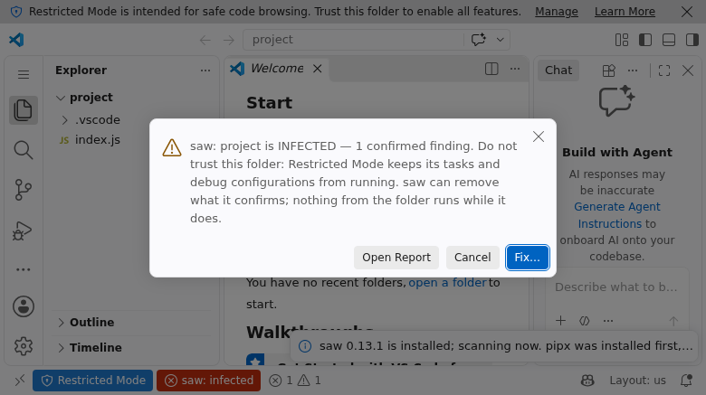
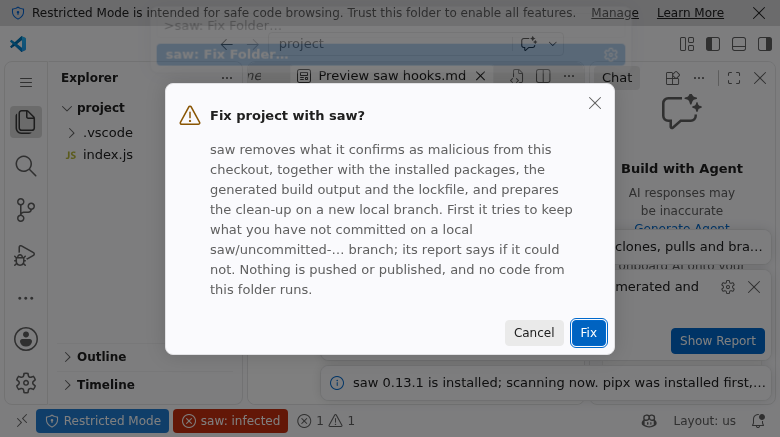
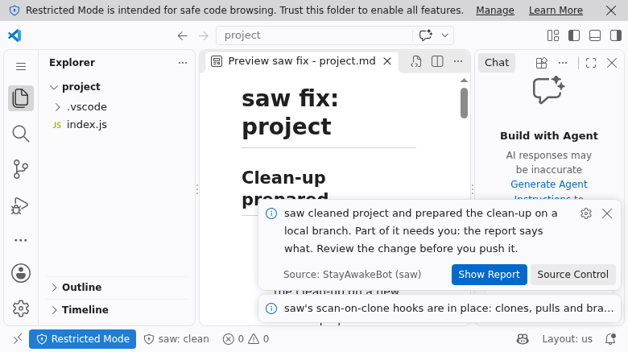

# StayAwakeBot (saw)

**Catch supply-chain worms before they run.** The [saw](https://saw-docs.ndevuspace.com/) scanner in
VS Code, Cursor, Antigravity, Devin Desktop and VSCodium: a verdict for every folder you open,
before you trust it.

[](https://marketplace.visualstudio.com/items?itemName=ndevu12.stayawakebot)
[](https://open-vsx.org/extension/Ndevu12/stayawakebot)
[](https://saw-docs.ndevuspace.com/)
[](LICENSE)



Supply-chain worms hide where a developer never looks: an editor task that runs when a folder
opens, an obfuscated loader in an installed package, a poisoned lockfile, a git hook that runs on
checkout. **saw** hunts them, and this extension runs saw for you. It scans each folder, shows the
verdict where you work, and, when you ask, cleans the folder up.

## Features

### A verdict for every folder

Each workspace folder is scanned when the window opens, and again when something that can run code
changes: a saved file, a checkout or pull, or a change under `.vscode/`, `package.json`, a lockfile,
a workflow or a git hook. The verdict appears in the status bar and the **saw** view, and findings
appear in the **Problems** panel.

| Verdict | Meaning |
| --- | --- |
| **infected** | At least one confirmed finding: the content is malicious. Don't trust, install, build or run anything in the folder. |
| **suspicious** | Heuristic findings only: something doesn't look right, and a person should decide. Nothing was changed. |
| **residue** | Traces an infection left behind. Nothing found runs, but it isn't what the project would carry. |
| **could not scan** | The folder couldn't be fully scanned: unknown, never clean. |
| **clean** | Nothing found, and the folder was fully scanned. |

Read [what each verdict means](https://saw-docs.ndevuspace.com/latest/explanation/verdicts/) in saw's
documentation.

### Safe before you trust a folder

Scanning only reads files, so it runs in **Restricted Mode**. When saw confirms malware in a folder
you have not trusted yet, the extension warns you before you trust it.

### Reports you can read

**Open Report** opens a folder's scan as a document in an editor tab: the verdict, what to do, and
every finding with its remedy and evidence. Fix, Audit and the hook commands open their own reports,
which update live as saw works. Reports are kept in the extension's own storage, never in your
project.

### Fix an infected folder

**Fix…** runs [`saw fix`](https://saw-docs.ndevuspace.com/latest/reference/cli/fix/) after you
confirm. It's available from the alert, from the infected folder in the saw view, or as
**saw: Fix Folder…**.

- **What it removes:** what saw confirmed as malicious, plus the installed packages, build output
  and lockfile.
- **Where the clean-up goes:** onto a new local branch. Nothing is pushed or published.
- **Your uncommitted work:** saw first tries to keep it on a `saw/uncommitted-…` branch. That needs
  git to know your name and email, and the confirmation warns you when it doesn't.
- **Restricted Mode:** Fix works there too. saw runs git with the repository's own hooks and
  settings switched off, so nothing from the folder runs.

When it's done, the folder is scanned again. With a saw that names the clean-up branch,
**Open Changes** shows the whole clean-up as one diff.



### Audit this machine

**saw: Audit This Machine** runs [`saw audit`](https://saw-docs.ndevuspace.com/latest/how-to/audit-a-machine/)
and tells you, in saw's own words, whether changing your passwords and tokens is safe yet. Changing
them while something on the machine still watches them can set off code that deletes your files.
See [credential hygiene](https://saw-docs.ndevuspace.com/latest/explanation/credential-hygiene/).

### Scan-on-clone hooks

The saw view shows whether saw's [scan-on-clone hooks](https://saw-docs.ndevuspace.com/latest/how-to/scan-on-clone/)
are in place, so every clone, pull and branch switch is scanned. It installs or repairs them in one
click.

### Guards for AI agents

- **`saw_folderVerdict` tool:** agents in the editor can ask for a folder's verdict before they
  install dependencies, run scripts or build. Reference it as `#sawVerdict` in chat.
  - It scans the latest changes first, and tells the agent to stop and ask you unless the folder is
    clean or only has residue.
  - It only reads, and never passes on the file contents saw quotes as evidence, so a malicious file
    can't slip instructions to the agent.
- **saw's MCP server:** when the installed saw provides `saw mcp`, the extension offers it to agents.
  - In Cursor, it registers through Cursor's MCP API.
  - In VS Code 1.101 or later, it appears as an MCP server named saw.
  - It's read-only. Turn it off with `saw.registerMcpServer`.



## Getting started

1. Install **StayAwakeBot (saw)**:
   - [VS Code](https://marketplace.visualstudio.com/items?itemName=ndevu12.stayawakebot): search for
     `stayawakebot` in Extensions.
   - [Cursor, Antigravity, VSCodium](https://open-vsx.org/extension/Ndevu12/stayawakebot): search
     for `stayawakebot` in Extensions.
2. Open a folder. The extension finds saw, installs it if needed, and scans.
3. Watch the status bar: `saw: clean`, or a warning when something needs you.

### Requirements

- **Linux or macOS** with **Python 3.11 or later**, on the machine where the files are. For
  Remote - SSH, WSL and dev containers, that's the remote.
- **Windows:** use WSL. See [Windows](#windows) below.

### How saw is installed

The extension uses the `saw` it finds on `PATH` or in `~/.local/bin`. When there's none, or it's too
old, the extension installs it in the background, without asking:

1. If pipx is missing, it installs pipx first, from a temporary environment it then deletes.
2. It installs saw with pipx, as the `stayawakebot` release this version was tested with.

Both come from PyPI as ready-built packages only, so no build script runs. No administrator rights
are needed, and nothing is written into the system Python. The status bar shows
`saw: installing` until saw is ready.

If the install fails, one notification says why and what to run, with **Retry**,
**Copy Diagnostics** and **Show Log**. To install saw yourself instead, see
[saw's first scan tutorial](https://saw-docs.ndevuspace.com/latest/tutorial/first-scan/).

## Commands

All commands are in the Command Palette under **saw:**.

| Command | What it does |
| --- | --- |
| **Scan Workspace** | Scan every workspace folder now. |
| **Open Report** | Open a folder's scan report, or the audit or hooks report. |
| **Fix Folder…** | Clean an infected folder with `saw fix`, after you confirm. |
| **Audit This Machine** | Check whether changing credentials is safe yet. |
| **Install Scan-on-Clone Hooks** | Scan every clone, pull and branch switch. |
| **Repair Scan-on-Clone Hooks** | Put saw's hooks back when something changed them. |
| **Install or Repair saw** | Reinstall saw at the tested release. |
| **Copy Install Diagnostics** | Copy the last install's details for an issue report. |
| **Show Log** | Open the extension's log. |
| **Open saw Documentation** | Open [saw-docs.ndevuspace.com](https://saw-docs.ndevuspace.com/). |

## Settings

| Setting | Default | Description |
| --- | --- | --- |
| `saw.path` | empty | Absolute path to `saw`. Empty: find it on `PATH` or in `~/.local/bin`, or use the one the extension installs. |
| `saw.autoInstall` | `true` | Install saw with pipx when it is missing or too old. Turn off where only an administrator installs software. |
| `saw.configPath` | empty | Your own saw config (allowlist), passed as `saw scan -c`. See [configuration](https://saw-docs.ndevuspace.com/latest/reference/configuration/). |
| `saw.scanOnStartup` | `true` | Scan every folder when the window opens. |
| `saw.scanOnChange` | `true` | Scan again on save, and when a file that can run code changes. |
| `saw.scanTimeoutSeconds` | `120` | How long one folder's scan may take. |
| `saw.registerMcpServer` | `true` | Offer saw's read-only MCP server to AI agents, when saw provides one. |

These are read from your **user** settings only. A folder's own `.vscode/settings.json` can't choose
which program runs or switch scanning off.

## Remote windows and Windows

### Remote - SSH, WSL and dev containers

The extension runs on the remote machine, where the files are. It finds or installs saw there, scans
the remote's files, and **Fix…** and the hooks act on the remote's git. **Audit This Machine** audits
that remote machine (the server, the WSL distribution or the container), not the computer in front
of you.

### Windows

saw doesn't run on native Windows yet, so the extension doesn't install it there. Use WSL:

1. Install WSL with Ubuntu: run `wsl --install` in an administrator PowerShell, then restart.
2. In Ubuntu, install what saw needs, once:

   ```bash
   sudo apt install python3 python3-venv pipx
   ```

3. Open your project in a WSL window. In VS Code, install the WSL extension and run
   **WSL: Open Folder in WSL…**; Cursor and other editors have their own WSL remote. Keep the project
   on the Linux side, for example `~/code/project` rather than `/mnt/c/…`.
4. Install this extension in the WSL window when asked. It installs saw inside WSL and scans.

## Privacy and safety

- **Nothing is sent anywhere.** saw scans offline. The only download is installing saw from PyPI.
- **Nothing changes without you.** Only **Fix…**, after you confirm, changes files. Nothing is ever
  pushed, and no pull request is opened.
- **Nothing from the folder runs.** saw is started without a shell, from settings the folder can't
  change.
- **Your shell profile is left alone.** Terminals opened in the editor get saw on `PATH`; for other
  terminals, run `pipx ensurepath` once.

Read how saw decides what to trust in its [trust model](https://saw-docs.ndevuspace.com/latest/explanation/trust-model/)
and why it [fails closed](https://saw-docs.ndevuspace.com/latest/explanation/fail-closed/).

## Troubleshooting

| You see | What to do |
| --- | --- |
| `saw: not available` | Click it. It installs or repairs saw, or tells you what's missing, such as Python 3.11. |
| `saw: could not scan` | Open the folder's report: it says why. A large folder may need a higher `saw.scanTimeoutSeconds`. |
| The install failed | Use **Copy Diagnostics** from the notification, and paste the result into an [issue](https://github.com/Ndevu12/saw_ide_extension/issues). |
| A verdict looks wrong | Detection lives in saw. Report it on [saw's issue tracker](https://github.com/Ndevu12/stayAwakeBot/issues). |

## Learn more

- [saw documentation](https://saw-docs.ndevuspace.com/): the official site
- [Your first scan](https://saw-docs.ndevuspace.com/latest/tutorial/first-scan/)
- [Verdicts](https://saw-docs.ndevuspace.com/latest/explanation/verdicts/)
- [Harden a repository](https://saw-docs.ndevuspace.com/latest/how-to/harden-a-repo/)
- [CLI reference](https://saw-docs.ndevuspace.com/latest/reference/cli/)
- [saw on GitHub](https://github.com/Ndevu12/stayAwakeBot) and [on PyPI](https://pypi.org/project/stayawakebot/)

## Feedback and contributing

- **Extension issues and ideas:** [saw_ide_extension issues](https://github.com/Ndevu12/saw_ide_extension/issues)
- **Detection issues:** [stayAwakeBot issues](https://github.com/Ndevu12/stayAwakeBot/issues)
- **Contributing:** see [CONTRIBUTING.md](CONTRIBUTING.md)
- **Release notes:** see [CHANGELOG.md](CHANGELOG.md)

## License

[BSD-3-Clause](LICENSE)
